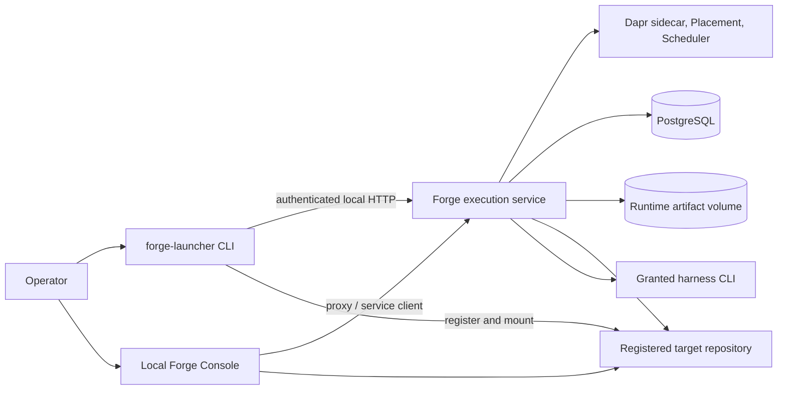

# Project Architecture Blueprint

**Verified:** 2026-10-22
**Scope:** MyForge source repository and its current local execution runtime.

This document describes the architecture that is implemented today. It is a
companion to [ARCHITECTURE.md](ARCHITECTURE.md), which gives the short overview.
The active requirements remain [docs/PRD.md](docs/PRD.md) and
[`docs/features/`](docs/features/); this blueprint is not a second requirements
source.

## 1. Architecture at a glance

MyForge is a local-first, PRD-driven authoring and execution toolchain. It
separates requirement authoring, manifest compilation, durable execution, and
operator-facing projection into distinct packages. The launcher coordinates
the local experience, while a Dapr-backed service owns supported run execution
and durable status. There is no hosted, multi-tenant execution control plane.

The main execution path is:

```text
PRD and feature documents
        │
        ▼
forge-execution-adapter ──► EXECUTION-MANIFEST.json
        │
        ▼
forge-launcher ──HTTP/bearer──► local Dapr execution service
                                      │
                          Dapr Workflow + worker activities
                          ┌───────────┴───────────┐
                          ▼                       ▼
                   PostgreSQL             registered repository
                   run/control data       worktrees and Git effects
                          │
                          ▼
                  file-backed artifacts
                          │
                          ▼
                  Forge Console / Board
```

The Dapr-independent contract and execution library live in
`tools/dapr-engine/contract/v1/` and `tools/dapr-engine/execution/`. Dapr
orchestration, persistence adapters, service APIs, and deployment wiring are
kept outside that reusable core.

## 2. System context and runtime topology



The supported local runtime is managed with rootless Podman Compose. The
deployment in `tools/dapr-engine/deploy/compose.yaml` contains PostgreSQL,
Dapr Placement, Dapr Scheduler, the `daprd` sidecar, and the Forge worker. The
worker's API is published on loopback (default host port `8483`) and requires a
bearer token. Launcher-generated overrides mount registered repositories into
the worker.

The worker image pins Node and the supported harness CLIs, and includes Git for
workspace preparation and checkpoint integration. Engine source, templates,
dependencies, and operator-granted harness credentials are mounted at runtime;
the source and grant mounts are read-only. Runtime data, PostgreSQL data, and
Dapr Scheduler data use persistent volumes. The host-tools Compose override is
intended for local operator access to PostgreSQL, also bound to loopback.

This is an operator-managed local runtime, not a production hosted topology.
Hosted deployment, multi-tenant isolation, and remote repository execution are
not current capabilities.

## 3. Component boundaries

| Component | Source | Responsibility |
| --- | --- | --- |
| Launcher | `scripts/forge-launcher/` | CLI entry points, bootstrap and authoring flows, runtime lifecycle, API client, package resources, and local Console server. |
| Authoring templates | `templates/skills/`, `templates/agents/` | PRD/feature-driven authoring and derived agent and skill resources for supported harnesses. |
| Execution adapter | `templates/skills/forge-execution-adapter/` | Validate authoring inputs and compile the execution manifest; it does not schedule runtime work. |
| Execution contract | `tools/dapr-engine/contract/v1/` | Versioned, Dapr-independent request, state, event, and behavior contracts. |
| Execution library | `tools/dapr-engine/execution/` | Reusable task, workspace, harness, and checkpoint execution primitives. |
| Dapr service | `tools/dapr-engine/service/`, `orchestration/`, `storage/` | Authenticated service API, durable workflows, storage adapters, harness registration, and worker activities. |
| Runtime deployment | `tools/dapr-engine/deploy/` | Compose services, pinned worker image, Dapr components, and database initialization. |
| Console | `scripts/forge-launcher/scripts/console/` | Local project and run views, API proxying, task controls, logs/artifacts, and Console-owned Board assets/layout. |
| Compatibility skill | `templates/skills/forge-workflow-engine/` | Fail-closed compatibility surface; it is not the active scheduler or a second run-state owner. |

### Ownership rules

- The execution adapter owns compilation; the runtime consumes the resulting
  manifest snapshot.
- The Dapr service owns active execution state, durable workflow progression,
  task controls, execution ownership, and Git-effect reconciliation.
- PostgreSQL is authoritative for service run and control records. Artifacts
  and task checkpoints are stored as files in runtime storage and referenced
  by service records.
- The launcher owns local runtime lifecycle, repository registration, and
  service communication. It is not a second workflow scheduler.
- The Console is a projection and control client. The Console Board's assets
  and layout logic are owned by the launcher package; the retired standalone
  engine visualization is not part of the runtime.
- Repository-local historical files such as `WORKFLOW-STATE.json` are not
  authoritative inputs to supported Dapr runs and are not imported as live
  execution state.

## 4. Execution flow

1. The operator selects or creates a target repository and installs the
   appropriate MyForge resources.
2. Requirements are authored and reviewed in the repository. Agent and skill
   resources are derived from the approved requirements using the selected
   harness context.
3. `forge-execution-adapter` validates source documents and writes
   `docs/EXECUTION-MANIFEST.json`.
4. The launcher submits a run with the manifest snapshot and registered
   repository identity to the loopback service API.
5. The service validates the request, persists its run records, and starts the
   Dapr Workflow. Workflow activities schedule tasks, prepare workspaces,
   invoke the selected harness, and capture checkpoints.
6. The service persists workflow state, task events, controls, ownership, and
   operation receipts in PostgreSQL. Artifact/checkpoint objects are written
   to runtime file storage.
7. Repository integration is fenced and reconciled by the service. The Console
   queries the service for run/task status and controls and reads permitted
   project artifacts for presentation.

The active service harnesses are `stub`, `copilot`, `claude`, and `opencode`.
Harness credentials are operator-granted and supplied to the selected harness
at runtime; credentials are not baked into the worker image or passed to task
processes as Dapr API authority.

## 5. Interfaces and communication

| Boundary | Mechanism | Notes |
| --- | --- | --- |
| Launcher → execution service | Versioned local HTTP API with bearer authentication | Service client and run commands live in the launcher package. The API is loopback-published by the local deployment. |
| Console browser → Console server | Local HTTP routes and session-bound controls | Console routes proxy supported operations and project status; they do not write the service's durable workflow state directly. |
| Service → Dapr | Dapr Workflow runtime/client and sidecar APIs | The sidecar token is service-only; task processes do not receive it. |
| Service → PostgreSQL | PostgreSQL driver and storage adapters | Durable run/task/control, ownership, receipt, and reconciliation data. |
| Service → artifacts | File-backed content-addressed checkpoint/artifact store | Runtime volume provides persistence; artifacts are not database blobs. |
| Service → target repository | Registered repository mount and Git operations | Launcher registration determines which repositories are available to the worker. |
| Worker → harness | Local pinned CLI process | Only the selected, operator-granted harness receives its credentials. |

## 6. Data and persistence

### Sources of truth

- `docs/PRD.md` and `docs/features/*.md` define active product requirements.
- `docs/EXECUTION-MANIFEST.json` is the compiled execution input for a run.
- PostgreSQL service records are the source of truth for supported Dapr run,
  task, control, ownership, and operation-receipt state.
- Runtime file storage holds artifacts and task checkpoints; database records
  refer to those files.
- Project-local logs and historical state documents may remain useful for
  human audit or migration history, but they do not override service state.

### Runtime state at rest

The default local Compose topology separates persistent PostgreSQL data,
runtime artifact data, and Dapr Scheduler data into named volumes. The launcher
creates installation-scoped environment and credential material outside the
source repository. Secrets are required environment inputs, not checked-in
values. Repository registration is represented by launcher-managed runtime
configuration and generated Compose mounts.

Database schema and adapter ownership belong to `tools/dapr-engine/storage/`
and the associated migration/bootstrap code. Contract changes must be
reflected in the versioned contract and its conformance fixtures, not only in
the service implementation.

## 7. Security and failure boundaries

- The local run API is bound to loopback and protected by a bearer token.
- The Dapr API token is available to the service sidecar integration, not
  ordinary task processes.
- Registered repository mounts constrain the repositories exposed to the
  worker; service code still validates repository identity and fences Git
  effects.
- Harness grants are separate from service API credentials and mounted
  read-only. The worker image contains tooling, not operator secrets.
- Engine source, templates, and package dependencies are mounted read-only in
  the worker; persistent state uses dedicated volumes.
- Rootless Podman and container isolation are part of the supported local
  deployment, but do not imply a hosted multi-tenant security boundary.
- Workflow recovery and operation receipts address retries and ambiguous
  effects. Do not add an automatic legacy-engine fallback or treat a
  repository state file as a recovery authority.

Operationally significant failures should surface through API errors, workflow
events, health checks, and explicit qualification failures. Missing runtime
prerequisites must not be reported as successful execution or silently skipped.

## 8. Observability and operator surface

The Console presents local projects and Dapr-backed runs. Run and task status
comes from the service API; the Board is a Console-owned visualization over
those status/task projections. The Console remains supported even though the
standalone engine visualization was retired.

Runtime health is checked by the worker health endpoint and Compose health
check. Service events, task details, artifacts, and control acknowledgements
are exposed through the service/Console surfaces. Do not treat generated
repository snapshots as a replacement for service state.

## 9. Testing and qualification

Use each package's own scripts, as described in `AGENTS.md` and
[`docs/testing-guide.md`](docs/testing-guide.md):

- `scripts/forge-launcher/`: launcher, Console, packaging, and service-client
  tests plus TypeScript typecheck.
- `tools/dapr-engine/`: contract conformance, execution, workflow, service,
  and storage tests plus TypeScript typecheck.
- Opt-in PostgreSQL integration tests: durable persistence, ownership/fencing,
  repository integration, and reconciliation behavior.
- `tools/runtime-qualification/`: live rootless-Podman tests for runtime
  failures, backup/restore, and upgrade behavior.

Unit tests and in-memory conformance fixtures are not substitutes for live
runtime durability or qualification evidence. The live qualification package
uses an isolated runtime and must not be confused with the normal `myforge-runtime`
installation.

## 10. Extension guidance

Place a change at the boundary that owns its behavior:

- Requirement semantics belong in `docs/PRD.md` or a feature specification;
  update their authoritative tests and release documentation.
- Manifest compilation belongs in `templates/skills/forge-execution-adapter/`.
- Reusable task or harness behavior belongs in `tools/dapr-engine/execution/`;
  Dapr-independent semantics belong in the contract where appropriate.
- Dapr workflow behavior belongs in `tools/dapr-engine/orchestration/`, with
  service endpoints and registration in `service/`.
- Durable schema behavior belongs in the storage adapters and migrations, with
  contract fixtures updated when the observable contract changes.
- Local lifecycle, API client, and Console behavior belong in
  `scripts/forge-launcher/`. Board rendering/layout changes stay Console-owned.
- Runtime image or topology changes belong in `tools/dapr-engine/deploy/` and
  require reviewing deployment qualification and installation migration.
- Target-project authoring resources belong in `templates/skills/` or
  `templates/agents/`, not in the service runtime.

For user-visible behavior, update the relevant `SKILL.md`, launcher/project
README, guide, architecture references, changelog, and ADR as directed by
[`docs/documentation-map.md`](docs/documentation-map.md). Keep P7 completion
markers tied to their documented acceptance evidence and merge gate.

## 11. Architecture decisions and constraints

- [ADR-079: Dapr execution cutover](docs/adr/079-dapr-execution-cutover.md)
  records the accepted cutover to the service-backed execution model. Its P7
  implementation does not restore the retired standalone visualization; the
  Console Board remains supported.
- The existing open cutover SDR records the rationale and alternatives. Do not
  create a duplicate ADR or promote the SDR into a second cutover ADR when
  ADR-079 already records the accepted decision.
- [docs/canonical-features.md](docs/canonical-features.md) defines the active
  requirements hierarchy. Plans, ADRs, changelogs, and execution snapshots
  supplement but do not replace it.
- Phase 7 plan items remain incomplete until their merge/evidence gates are
  satisfied; unmerged work is not represented as completed architecture.
