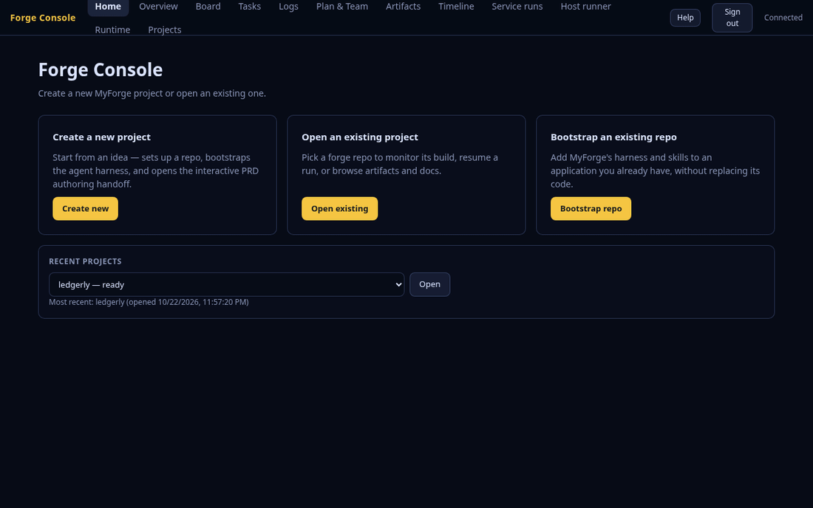

# MyForge

[](LICENSE)


> MyForge turns an idea into a reviewed PRD, a specialist agent team, and an autonomous build.

**Latest: v3.146** — see [docs/updates.md](docs/updates.md) for release notes.

MyForge is a PRD-first workflow for turning product requirements into working software. It combines structured planning, agent-based implementation, and execution orchestration in one path so a project can move from concept to build without losing the review checkpoints that matter.

Every solution uses a PRD and one or more canonical feature documents.
Requirements and tasks have one owning location; compact task contracts resolve
shared IDs into complete execution instructions. Legacy source documents must be
converted before building. See [Canonical Features](docs/canonical-features.md).

## Highlights

- Keeps the PRD as the quality gate before implementation begins.
- Generates a specialist agent team from the PRD instead of relying on a single generic assistant.
- Supports both guided, interactive execution and unattended "dark orchestration" runs.
- Includes a local web console for monitoring builds and administering the
  complete local runtime, including repository registration and backups.
- Can explicitly run a locally installed harness CLI through Dapr; host
  execution is unsandboxed and uses the logged-in user's full OS permissions.
- Can bootstrap MyForge into an existing Git repository without replacing its application code.

## Dapr replacement work in this fork

The [implementation tracker](plan.md) records the accepted P0–P7 gates, the
native local host-runner qualification still in progress, and the separate
hosted-deployment phase.
The [foundation PRD](docs/PRD.md) and
[feature contracts](docs/features/dapr-foundation.md) cover the first increment.
The isolated `tools/dapr-spike` experiment is not the production engine. The
launcher requires a running local Dapr service and registered repositories for
execution; the runtime uses rootless Podman, and legacy histories are not
imported. See the
[cutover and rollback procedure](docs/forge-launcher.md#cut-over-from-the-legacy-engine).




See the [Forge Console visual tour](docs/forge-console-screenshots.md) for
the full screenshot walkthrough, including current responsive captures.


## Quick start

### Prerequisites

- Node.js 18+
- Git
- A compatible agent harness such as GitHub Copilot, Claude Code, or opencode
- Rootless Podman for Dapr-backed build execution

### Option 1: Run from a clone

```bash
git clone https://github.com/McFuzzySquirrel/my-forge.git
cd my-forge
cd scripts/forge-launcher
npm install
npm run build
node dist/cli.js
```

The shell wrapper delegates to the built Node package and remains available for
compatibility with existing workflows for one release after the package
migration. For new usage, run the package directly with `node dist/cli.js` from
`scripts/forge-launcher`; when the package is available from your registry, use
`npx forge-launcher@beta`.

### Option 2: Install the npm package from source

The npm package is not published yet, but the current pre-release is
`forge-launcher@1.0.0-beta.6`. You can install it locally from this repository:

```bash
git clone https://github.com/McFuzzySquirrel/my-forge.git
cd my-forge/scripts/forge-launcher
npm install
npm pack
npm install -g ./forge-launcher-1.0.0-beta.6.tgz
```

Once installed, run:

```bash
forge-launcher
```

The launcher walks you through repo bootstrap, idea capture, PRD drafting, team generation, and build execution. The Console also supports bootstrapping an existing repository and adding Feature PRDs to completed projects.

For the manual prompting flow and the CLI’s expected prompts, see [docs/prompt-playbook.md](docs/prompt-playbook.md). For the latest changes and release notes, see [docs/updates.md](docs/updates.md).

> [!NOTE]
> The canonical launcher runtime lives in [scripts/forge-launcher](scripts/forge-launcher). The shell wrappers are deprecated compatibility shims retained for one release after the package migration.

## How it works

1. Capture your idea and review the PRD.
2. Generate the agent team and any model plan.
3. Run the build interactively or unattended.

## Main components

- `forge-launcher` - the entry point for onboarding, authoring, and launching builds
- Dapr execution service - the supported engine for durable orchestration, checkpoints, replay, and run state
- `forge-execution-adapter` - compiles the authored plan into the execution manifest consumed by the Dapr service
- Legacy workflow-engine package - historical reference only; new runs use the registered Dapr service
- Forge Console - a local web UI for authoring, monitoring, and controlling runs

## Documentation

- [docs/task-contracts.md](docs/task-contracts.md)
- [docs/forge-launcher.md](docs/forge-launcher.md)
- [docs/forge-console.md](docs/forge-console.md)
- [docs/forge-console-user-guide.md](docs/forge-console-user-guide.md)
- [Dapr cutover and rollback](docs/forge-launcher.md#cut-over-from-the-legacy-engine)
- [Legacy workflow-engine reference](docs/workflow-engine.md)
- [Legacy workflow-engine deep dive](docs/workflow-engine-deep-dive.md)
- [docs/artifact-store-deep-dive.md](docs/artifact-store-deep-dive.md)
- [docs/research/myforge-agentic-development-value-chain.md](docs/research/myforge-agentic-development-value-chain.md)
- [docs/prompt-playbook.md](docs/prompt-playbook.md)
- [docs/updates.md](docs/updates.md)
- [ARCHITECTURE.md](ARCHITECTURE.md)
- [Project Architecture Blueprint](Project_Architecture_Blueprint.md)
- [CONTRIBUTING.md](CONTRIBUTING.md)

## Development

```bash
cd scripts/forge-launcher
npm install
npm test
npm run typecheck
```
