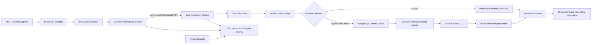

# Local Execution Architecture

> **Current architecture:** this guide describes how MyForge runs Dapr-backed
> service runs on an operator-managed local runtime. The retired in-process
> workflow engine is historical; it is not the current scheduler.

This is the system-level overview of the path from a compiled execution
manifest to verified repository changes. The launcher submits and observes
runs, Dapr owns durable orchestration, and a harness runner performs each task
attempt. The default runner invokes a harness in the worker container; an
explicit host-execution selection delegates that attempt to the local host
runner.

For command syntax and runtime administration, see the
[launcher guide](forge-launcher.md). For required behavior, see the
[Dapr execution feature](features/dapr-execution-boundary.md) and the
[host-execution feature](features/local-host-harness-execution.md). The
[versioned execution contract](contracts/dapr-execution-v1.md) is normative
for contract fields and invariants.

## The execution path at a glance

The principal responsibilities are:

| Part | Responsibility |
|---|---|
| Execution adapter | Validates authored requirements and compiles the manifest. |
| Launcher service-run client | Selects a registered repository, prepares a submission snapshot, calls the local service, and follows status. |
| Dapr execution service | Authenticates requests, validates and stores submissions, registers workflows and activities, and exposes run state and controls. |
| Dapr Workflow | Owns durable run/task scheduling, retries, waits, and control-event handling. |
| `ExecutionHost` | Executes task activities, supervises attempts, verifies outcomes, publishes checkpoints, and integrates accepted changes. |
| Worker harness runner | Invokes the selected harness in the worker container; this is the default mode. |
| Native host runner | Polls the service for jobs and invokes a locally installed harness only when host mode is explicitly selected. |
| Forge Console | Projects authoring and service-run state; it is an operator client, not an execution authority. |

## A run from source to result

1. Requirements and agent instructions are authored in the target repository.
   The execution adapter validates them and writes
   `docs/EXECUTION-MANIFEST.json`.
2. `forge-launcher engine-run` or `forge-launcher service submit` resolves the
   registered repository and selected harness. The launcher prepares an
   immutable submission snapshot, including the manifest digest, target
   `forge/<base>` branch, task selection, settings, and workflow-definition
   version.
3. The launcher sends the snapshot to the authenticated local execution
   service. The service validates repository and target-ref ownership,
   supported harness configuration, task selection, and configured run bounds.
   It persists the accepted submission before scheduling the Dapr run workflow.
4. Dapr Workflow schedules ready tasks and records durable waits, retries, and
   controls. Each task attempt is dispatched to an activity hosted by
   `ExecutionHost`.
5. The activity prepares a disposable workspace and chooses a runner from the
   accepted run settings. In worker mode, the activity invokes the selected
   adapter locally in the worker. In host mode, it submits a typed request to
   a durable PostgreSQL queue and waits for the host runner to return the
   result.
6. The activity applies the same output, no-op, structured-result, and
   validation gates to either execution mode. Accepted changes are checkpointed
   and integrated into the run's Forge branch. The service publishes run
   status and lifecycle events for launcher and Console clients.

The checked-out branch is not used as the service run's integration target.
Run changes are committed to the run's `forge/<base>` branch; use the service
merge operation to fast-forward the checked-out branch when appropriate.

## Worker mode and host mode

| | Worker mode (default) | Native host mode (explicit) |
|---|---|---|
| Harness process | Runs in the local runtime's worker container. | Runs on the machine that manages the runtime. |
| Selection | Used when host execution is not requested. | Opted into for a run; the service also requires a capability for that repository. |
| Provider authentication | Uses credentials granted to the runtime for the selected harness. | Uses that local CLI's normal host authentication. |
| Workspace handoff | The worker activity operates on its managed workspace. | The host runner clones the registered repository at the accepted base revision, runs in a disposable attempt workspace, and returns a bounded binary Git diff. |
| Permissions | Constrained by the worker container's runtime configuration. | The harness and its child tools run with the operator's normal OS permissions; there is no task sandbox. |

The runner choice changes where the harness process runs; it does not transfer
workflow ownership. Dapr remains responsible for scheduling, timeouts,
validation, checkpoint publication, cancellation, and repository integration.
Host mode never silently falls back to the worker harness.

The host-runner capability authorizes Dapr-to-runner requests for one
registered repository. It is distinct from provider credentials, the service
API token, Dapr sidecar authentication, and Git credentials. It does not limit
the local harness's OS permissions or restrict it to the task workspace.

## Runtime and authority

The launcher manages the local Podman deployment, including PostgreSQL, the
Dapr sidecar and workflow dependencies, and the Forge worker. The service API
is exposed on loopback and protected by a bearer token. The host runner makes
outbound polling requests to that service; it does not expose a remote listener.

Each store has a specific role:

- **Dapr Workflow history** is the durable orchestration record.
- **PostgreSQL application records** hold accepted submissions, run/task
  status, controls, ownership and receipts, and durable host-runner jobs.
- **File-backed artifacts and checkpoints** hold validated execution
  artifacts and workspace snapshots.
- **Local runtime data** holds operator credentials and host-runner
  capabilities with restrictive file permissions where supported.

`docs/WORKFLOW-STATE.json` and other files from the retired scheduler are not
current execution authority. The service reconstructs its in-memory run
bindings from accepted submissions when it starts.

## Operational entry points

- Use `forge-launcher runtime` to start, stop, inspect, and configure the local
  runtime and registered repositories.
- Use `forge-launcher engine-run` or `forge-launcher service` to submit, follow,
  inspect, and control service runs.
- Use the Forge Console's **Service runs** view for run-level monitoring and
  controls, and its **Host runner** view for runner readiness, capabilities,
  and bounded job summaries.

The [launcher guide](forge-launcher.md) documents commands and options. The
[Console user guide](forge-console-user-guide.md) documents the operator
workflow. This architecture overview intentionally does not duplicate those
procedures.

## Related documentation

- [Dapr execution feature and requirements](features/dapr-execution-boundary.md)
- [Native host-execution feature and requirements](features/local-host-harness-execution.md)
- [Dapr execution contract v1](contracts/dapr-execution-v1.md)
- [Forge Launcher command guide](forge-launcher.md)
- [Forge Console user guide](forge-console-user-guide.md)
- [ADR-066: Dapr workflow replacement architecture](adr/066-dapr-workflow-full-replacement-architecture.md)
- [ADR-069: service-run submission and repository binding](adr/069-service-run-submission-and-repository-binding.md)
- [ADR-071: service harnesses and execution entry points](adr/071-service-harnesses-and-execution-entry-points.md)
- [ADR-079: Dapr execution cutover](adr/079-dapr-execution-cutover.md)
- [Code-grounded local execution deep dive](local-execution-deep-dive.md)
